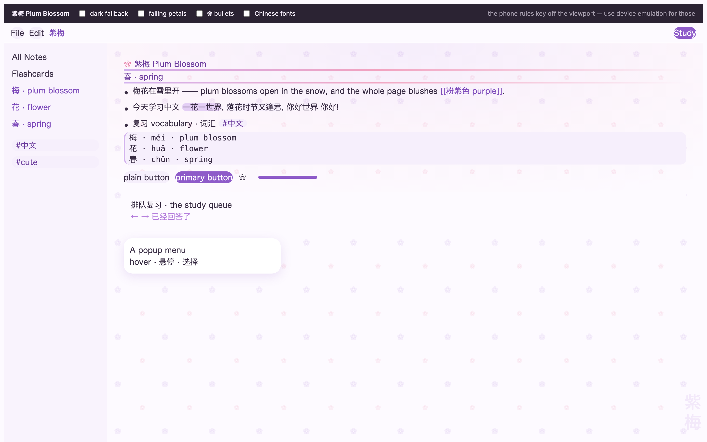
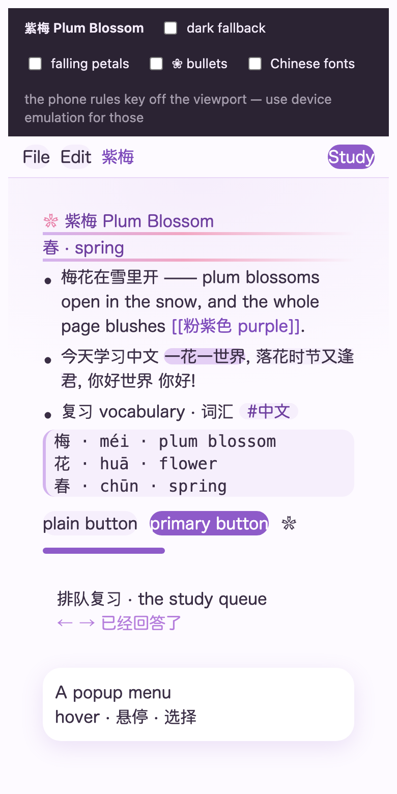
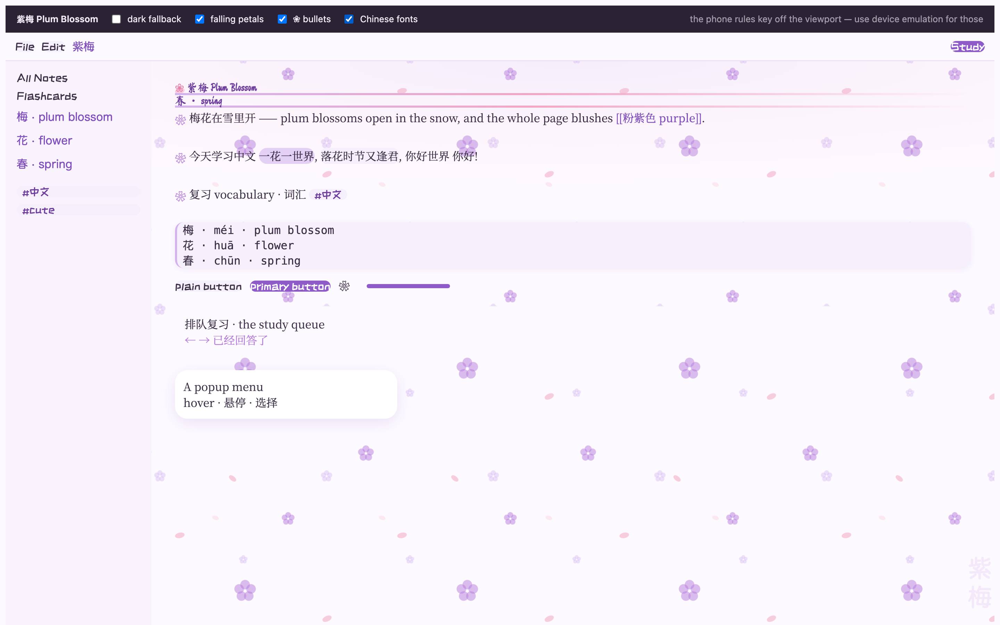
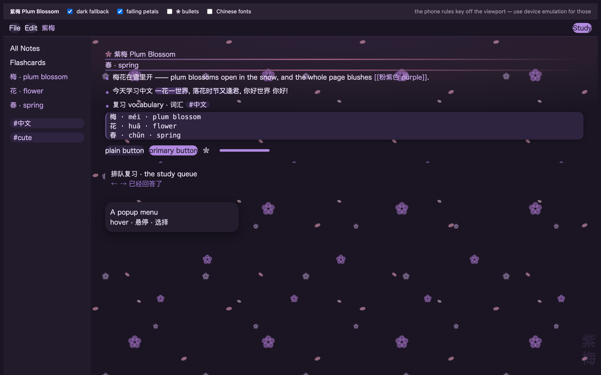

# 紫梅 Plum Blossom · a cute purple theme for RemNote

A light, girly, Chinese-inspired theme for RemNote: soft rice-paper whites,
wisteria purple (紫) and petal pink (花瓣), rounded corners, pastel
highlighters, and a quiet plum-blossom texture with 紫梅 written vertically in
the corner.

Light is the theme. Dark mode is only a small fallback (紫梅夜色) so that
flipping RemNote to dark does not leave you with a half-broken app — you can
delete that one section and never think about it again.

Built on RemNote's documented stable classes (`rn-*`, `rn-clr-*`,
`--rn-clr-*`, `--rn-colors-*`, `--highlight-color-*`) plus a handful of
long-standing internal ones that the Catppuccin theme also relies on
(`.rn-popup__content`, `.rn-checkbox--*`, `.rn-button--primary`,
`.rn-settings__link`, `.rn-date-picker`) — so it should survive RemNote
updates. Works on desktop, the web app **and the mobile app**.

Every rule was rendered and checked in a real browser (Chromium, 1440px and
390px) before shipping; the screenshots below are that run.

---

## Preview it first

Open `preview.html` in a browser — it renders mock RemNote markup with the real
theme, and has toggles for the dark fallback and each extra.

For the phone rules, use your browser's device emulation (⌥⌘M in Chrome,
*Develop → Enter Responsive Design Mode* in Safari): the phone layout keys off
the viewport, not the window.

### 预览 / screenshots



*Light — 宣纸 paper, plum purple, pastel highlighters, the blossom tile, and
紫梅 in the corner.*

| Phone · 390px | Extras on | Dark fallback |
| --- | --- | --- |
|  |  |  |

(The image links are absolute `raw.githubusercontent.com` URLs so that they also
render in the RemNote marketplace, which shows this README. If you rename the
repo, update them and `repoUrl` in `manifest.json`.)

The phone shot shows the real mobile rules at work: the blossom tile and the
紫梅 watermark step aside, the queue and chrome go solid, and the add button
keeps clear of the home indicator.

---

## Install

### A. As a Theme plugin — recommended, and the only route that works on mobile

1. Zip `theme.css`, `manifest.json` and `README.md` together, with those three
   files at the **root** of the zip. `./build-theme-zip.sh` does it for you and
   writes `dist/plum-blossom-theme.zip`.
2. In RemNote: **Plugins and Themes → Build → Upload Theme**.
3. Turn it on in the theme list. Tick *Show Themes* if the list looks empty.

`"enableOnMobile": true` is already set in the manifest, which is what tells
RemNote to apply it on phones and tablets too.

RemNote validates the manifest hard, so `build-theme-zip.sh` checks it against
the same rules first (id 5–100 chars of `[A-Za-z0-9_-]`, name/author 3–100
chars, `repoUrl` **required** and a real `http(s)://` URL, description at most
200 characters, `theme` only `light`/`dark`). It fails loudly instead of letting
RemNote reject the upload.

`repoUrl` currently points at `https://github.com/bassmd/remnote-plum-blossom-theme`
— point it at wherever you actually host the theme.

### B. As Custom CSS — the fastest route (desktop + web)

1. Open the **Custom CSS** powerup page (search for `Custom CSS` in the omnibar).
2. Add a CSS block and paste all of `theme.css` into it.
3. It applies live while you edit.

This is the nicest way to tweak colours: change a value in section 0 and watch
the app change with it. Paste each extra into its **own** CSS block.

### C. As a Snippet plugin

Same as A, but rename `theme.css` to `snippet.css` and set `"theme": []` in
`manifest.json`, then upload from the **Build → Upload Plugin** tab.

---

## What it changes

| Area | What you get |
| --- | --- |
| Surfaces | violet-tinted paper whites, layered rather than grey |
| Text | warm purple ink (`#3a2e45`), never pure black |
| Accent | wisteria purple `#8e5bc9`, links at `#7e4cbb` (5.6:1 on paper) |
| Highlighters | six pastel colours, pill-shaped, ink stays readable |
| Headings | plum→petal gradient underline, and a `❀` before H1/H2 |
| Popups, menus, dialogs | white, 18px radius, soft plum shadow |
| Buttons, switches, checkboxes | plum fills, pill switches, a plum ✓ |
| Clozes | lavender slot with a plum underline |
| Code blocks | lavender slab with a plum spine, monospace kept |
| Tags / powerups | little plum sweets |
| Folders & documents | RemNote's own icon fills tinted plum |
| Study queue | paper background, plum progress bar |
| Dividers | plum→petal gradient line |
| Scrollbars, selection | plum thumb, plum blush |
| Decoration | blossom tile + wash on the document, vertical 紫梅 watermark |

**Mobile & touch (all behind media queries, so desktop is untouched):**

- solid paper backgrounds for the queue and mobile chrome (the phone app paints
  solid instead of layered)
- the blossom tile and the 紫梅 watermark step aside on small screens, so
  decoration never competes with your notes
- the format toolbar keeps 6px off the screen edges
- the add button clears the home indicator on notched phones
  (`env(safe-area-inset-bottom)`)
- no sticky hover states after a tap, and a plum tap highlight
- `text-size-adjust: 100%` so iOS does not inflate your text

**Accessibility:** visible `:focus-visible` outline, `::selection` in plum,
`prefers-reduced-motion` respected, and every text colour checked against
WCAG AA on the paper background.

---

## Make it yours

`theme.css` is one file in six numbered sections. Almost everything you would
want to change lives in section **0. Palette**:

```css
--pb-plum-500: #8e5bc9;  /* the main purple: buttons, switches, accent */
--pb-petal-300: #f2a7c3; /* the pink used in gradients and headings */
--pb-paper-1: #fdfaff;   /* the page itself */
--pb-radius-lg: 18px;    /* how round the popups are */
```

Change those and the whole theme follows — every RemNote token in section 1 is
written as `var(--pb-*)`, never as a literal colour. If you want it pinker,
raise `--pb-petal-*`; if you want it colder, move `--pb-plum-*` toward blue.

Things you may want to switch off, each marked in the file:

| Want | Do |
| --- | --- |
| No watermark | delete the `body::after` block in section 3 |
| No blossom tile | remove `var(--pb-petals)` from `.rn-document-wrapper` |
| No `❀` before headings | delete the `.rn-text-heading-large::before` block |
| No rounded font | delete the `body, .rn-text, .rn-editor-container` font rule |
| No dark fallback | delete section 6 (the last block in the file) |
| Dark-only theme | move the section 6 values into section 1 |

---

## Extras (optional, paste each as its own CSS block)

| File | What it does | Notes |
| --- | --- | --- |
| `extras/falling-petals.css` | 落花 — the blossom tile drifts slowly across the document | pure CSS, behind your text, slower and dimmer on phones, still under `prefers-reduced-motion` |
| `extras/blossom-bullets.css` | plum bullets, and `❀` instead of the dot | **experimental**: the dot's markup is internal, so it is written to degrade gently. Variant A is safe; Variant B may need the negative margin nudged |
| `extras/chinese-fonts.css` | 马善政 headings, Noto Serif SC body, 站酷快乐体 labels | loads Google Fonts, so it needs to be online the first time; paste it on its own because `@import` must come first in a stylesheet |

None of them are required, and nothing in `theme.css` depends on them.

---

## If something looks wrong

Visit **`remnote.com/notes?disableCustomCSS`** — it loads RemNote with all
custom CSS off, which is RemNote's own escape hatch for a theme that locks you
out. Then fix or remove the offending block.

To find the class RemNote is actually using for an element, install the
**CSS Selector Helper** plugin and click the element.

---

## Publishing it to the Theme Marketplace

**RemNote requires `repoUrl` to be an existing *public* GitHub repo** — it
fetches the URL and rejects the upload otherwise (`Repo URL must point to a
public GitHub repo`). The manifest now points at
`https://github.com/Shadowsx3/remnote-plum-blossom-theme`, which exists and is
public — but it is still **empty**, so push the files before uploading (the
README screenshots are served from that repo too). See
**[PUBLISHING.md](PUBLISHING.md)**.

```bash
git push -u origin main      # or drag-and-drop in the browser, see PUBLISHING.md
./build-theme-zip.sh         # want: repoUrl reachable … (HTTP 200)
```

then upload `dist/plum-blossom-theme.zip` from
**Plugins and Themes → Build → Upload Theme**.

---

## 中文说明

这是一个浅色、可爱、中式风格的 RemNote 主题：宣纸底、紫藤紫、花瓣粉，圆角、
柔和的高亮色，背景有淡淡的梅花纹理，右下角竖排写着「紫梅」。

- **主要颜色**在 `theme.css` 第 0 节（Palette），改那几个变量就能换整套配色。
- **手机与平板**：`manifest.json` 里 `"enableOnMobile": true`；所有手机样式都写在
  媒体查询里，桌面版不受影响。小屏幕上会隐藏梅花纹理与「紫梅」水印。
- **深色模式**只是兜底（紫梅夜色），不用的话可以整段删掉第 6 节。
- **预览**：用浏览器打开 `preview.html`，可以切换深色模式与三个附加效果。
- **附加效果**（可选，各自单独粘贴）：`extras/falling-petals.css` 落花飘动、
  `extras/blossom-bullets.css` ❀ 项目符号、`extras/chinese-fonts.css` 中文字体。
- 出问题可以用 `remnote.com/notes?disableCustomCSS` 先关掉所有自定义 CSS。

---

## Files

```
theme.css                 the theme (light first, six sections)
manifest.json             Theme plugin manifest, enableOnMobile: true
README.md                 this file (also what the marketplace shows)
PUBLISHING.md             how to publish: create the public repo, then upload
preview.html              local preview with toggles
build-theme-zip.sh        validates the manifest, builds dist/plum-blossom-theme.zip
extras/falling-petals.css
extras/blossom-bullets.css
extras/chinese-fonts.css
docs/preview-*.png        screenshots from the rendered Chromium run
LICENSE                   MIT
```

## Credits

Colour and structure choices were checked against the official
[RemNote theme template](https://github.com/remnoteio/remnote-theme-template)
and the [Custom CSS docs](https://plugins.remnote.com/custom-css) (class list,
design tokens, dark-mode and mobile guidance). The Catppuccin RemNote theme was
useful as a reference for which tokens are worth overriding, and which of
RemNote's literal colours need a class rule of their own.

MIT licensed — see `LICENSE`.

